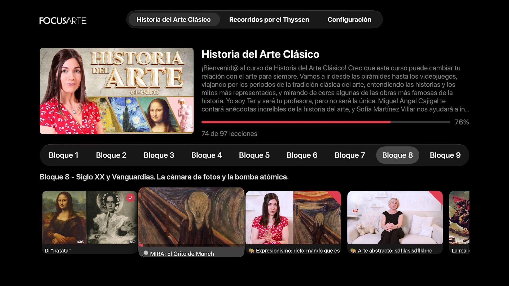

# FocusarteTV

> **Proyecto no oficial.** FocusarteTV no está afiliado, asociado ni respaldado por
> Focusarte ni por Kajabi. Es un cliente independiente hecho para uso personal.
> “Focusarte”, su contenido y sus marcas pertenecen a sus respectivos dueños.

> **Se necesita una cuenta.** La app no incluye ni desbloquea contenido: es solo un cliente
> que facilita ver el contenido que ya se adquirió en Focusarte. Para usarla hace falta una
> cuenta activa con el curso comprado.

Cliente nativo de tvOS para [Focusarte](https://www.focusarte.com) (Historia del Arte
Clásico).

<p align="center">
  
</p>

La web de Focusarte corre sobre **Kajabi** y es server-rendered. La app no usa un backend
propio: habla HTTP directamente contra el sitio con la sesión del miembro, parsea el HTML,
resuelve los videos de Wistia a HLS y reporta el progreso a los endpoints de Kajabi.

## Estado

App funcional, en desarrollo activo:

- Login contra focusarte.com con Keychain y re-login silencioso.
- Biblioteca con una pestaña por curso: bloques, carrusel de lecciones y progreso.
- Reproducción HLS a pantalla completa con PiP, autoplay y tarjeta Up Next.
- Foco que sigue la lección actual y, al entrar a un bloque, cae en la primera lección sin completar.
- Visor de PDFs a pantalla completa para las descargas de cada lección (Core Graphics,
  sin PDFKit): se abre desde el botón de descarga y Menú vuelve al post.
- Cache de imágenes y precarga de miniaturas de todo el curso en segundo plano.

### Limitaciones conocidas

- El **relleno automático de contraseñas** de tvOS no entrega credenciales a esta app
  porque falta la asociación de dominio (`apple-app-site-association` en focusarte.com) y
  el `.ipa` se distribuye sin firmar. Hay que copiar y pegar desde el iPhone. Detalle en
  [`docs/login-autofill.md`](docs/login-autofill.md).
- Las credenciales se guardan en el Keychain privado de la app (solo este dispositivo)
  para poder re-loguear en silencio cuando expira la sesión de Kajabi.

## Requisitos

- Apple TV 4K (2022) o cualquier equipo con tvOS 17+
- No hace falta Mac para compilar: el `.ipa` se genera en GitHub Actions
- Para probar el núcleo en local: Docker (`swift:6.2`)

## Instalar

El `.ipa` sin firmar se descarga desde la página de
[releases](../../releases) del repositorio.

Para compilarlo manualmente, el workflow
[`tvos-ipa.yml`](.github/workflows/tvos-ipa.yml) sirve de guía: instala XcodeGen, genera el
proyecto desde `apps/tvos/project.yml`, archiva con `xcodebuild` y empaqueta el `.ipa` sin
firmar.

## Tests

El núcleo corre sin Mac ni tvOS:

```bash
docker run --rm -v "$PWD/apps/tvos/FocusarteCore:/pkg" -w /pkg swift:6.2 swift test
```

## Documentación

- [`docs/kajabi-protocol.md`](docs/kajabi-protocol.md) — protocolo real de Focusarte/Kajabi
  (login, sesión, parseo, video, progreso)
- [`docs/login-autofill.md`](docs/login-autofill.md) — por qué el relleno automático de
  contraseñas no funciona y qué haría falta
- [`AGENTS.md`](AGENTS.md) — convenciones para trabajar en el repo
